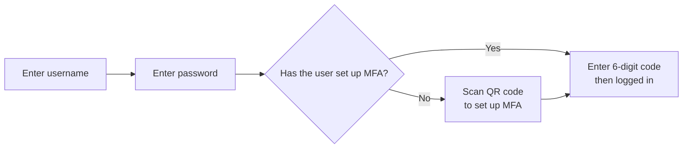

# Authentik TOTP MFA Lab (Beginner)

In this lab I added a second step to logging in to Authentik. After typing their password, users also have to type a 6-digit code from an app on their phone. If someone hasn't set this up yet, Authentik shows them a QR code to scan before they can finish logging in.

> I built this in my own practice lab, not on a real company system.

## Contents

- [Key terms](#key-terms)
- [The problem and the fix](#the-problem-and-the-fix)
- [What I used](#what-i-used)
- [How the login works](#how-the-login-works)
- [Build steps](#build-steps)
- [Testing](#testing)
- [Screenshots](#screenshots)
- [What I'd improve for a real company](#what-id-improve-for-a-real-company)

## Key terms

- **Authentik:** a free tool that handles logins for your apps. It's called an *identity provider*.
- **MFA (multi-factor authentication):** logging in with more than one thing. Here that's something you know (your password) plus something you have (your phone).
- **TOTP (time-based one-time password):** a 6-digit code made by an app on your phone. It changes every 30 seconds, so an old code stops working.
- **Authenticator app:** the phone app that makes the codes. I used Google Authenticator.
- **Flow:** the list of steps Authentik walks a user through, like logging in.
- **Stage:** one step inside a flow, such as "enter your password".
- **Stage binding:** the setting that puts a stage into a flow and decides its order.

## The problem and the fix

**Problem:** Logging in to Authentik only needed a password. If someone guessed, phished or leaked a password, that was enough to get into the account.

**Fix:** I added a second step. After the password, users now type a 6-digit code from the authenticator app on their phone. A stolen password on its own is no longer enough to log in.

## What I used

| What | Choice |
|---|---|
| Identity provider | Authentik |
| MFA method | TOTP: 6-digit codes that change every 30 seconds |
| Authenticator app | Google Authenticator |

## How the login works

Authentik's login flow runs these stages in order:

The code check happens after the password and before the user is logged in.

## Build steps

1. **Create the TOTP setup stage.** This is the stage that shows the QR code and saves the user's phone as their authenticator. I set it to 6-digit codes.
2. **Set up the Authenticator Validation stage** in the login flow. This is the stage that checks the code. I chose:
   - Device classes: **TOTP** (accept codes from an authenticator app)
   - Not configured action: **Force the user to configure an authenticator** (anyone without MFA has to set it up)
   - Configuration stages: the TOTP setup stage from step 1 (where to send them to set it up)
3. **Check the stage bindings** so the code check comes after the password and before the user is logged in.
4. **Create a test user** (Kate) and give her a password.

## Testing

| What I tested | What happened |
|---|---|
| Kate logs in for the first time, in a private browser window | After her password, Authentik showed a QR code. I scanned it with the authenticator app, typed the code and reached her dashboard. |
| Kate logs in again | Authentik asked for a code instead of showing the QR code. |
| Typing a wrong or expired code | Authentik rejected it. |

## Screenshots

A walkthrough of the build and test, in order.

**Figure 1:** Setting up the Authenticator Validation stage: TOTP as the device class, and users without MFA are forced to set up an authenticator.

**Figure 2:** The login flow that the validation stage is added to.

**Figure 3:** The stage bindings, showing the code check runs after the password and before the user is logged in.

**Figure 4:** The list of users in Authentik.

**Figure 5:** The Authentik login page.

**Figure 6:** Selecting the test user, Kate, to sign in with.

**Figure 7:** Because Kate didn't have MFA set up, after her password she's shown a QR code to set up the authentication factor.

**Figure 8:** Kate's own account (user side) after she logged in, showing her MFA is now set up.

**Figure 9:** The admin side, confirming MFA has been set up for Kate, along with the event log.

**Figure 10:** Now that MFA is set up, signing in asks for the one-time password (OTP) instead of the QR code.

**Figure 11:** After entering the OTP, Kate is logged in.

## What I'd improve for a real company

- **Stronger MFA:** TOTP codes can still be stolen by a fake login page (phishing). I'd offer passkeys or security keys (YubiKey, Windows Hello, Touch ID), which can't be phished that way, and make admins use them.
- **Monitoring:** send Authentik's events, like failed code attempts and new phones being set up, to a SIEM (a tool that collects security logs) and get alerts when there's a sudden jump.
