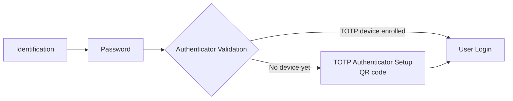

# Authentik TOTP MFA Lab

In this lab I added a second login factor to Authentik. After entering their password, users must type a 6-digit code from an authenticator app. Users who haven't set up MFA yet are sent to a QR-code enrollment screen before they can finish logging in.

> Built in a personal lab environment, not in production.

## The problem and the fix

**Problem:** Logging in to Authentik only needed a password. If a password was guessed, phished or leaked, that alone was enough to get into the account.

**Fix:** I added a second layer of security. After their password, users now have to enter a 6-digit code from an authenticator app on their phone. A stolen password alone is no longer enough to log in.

## Tech 
| Identity provider | Authentik |
| MFA method | TOTP (time-based one-time password), 6 digits, 30-second codes |
| Authenticator app | Google Authenticator |

## How the login flow works

In Authentik, a *flow* is an ordered list of *stages*, and *stage bindings* set the order. The default login flow runs:

The code check sits after the password and before the user is logged in.

## Build steps

1. **Create the TOTP Authenticator Setup stage.** This stage shows the QR code and saves the user's device (6 digits).
2. **Configured the Authenticator Validation stage** in the login flow:
   - Device classes: **TOTP**
   - Not configured action: **Force the user to configure an authenticator**
   - Configuration stages: the TOTP setup stage from step 1
3. **Check the stage bindings** so the code check runs after the password and before User Login.
4. **Create a test user** (Kate) and set a password.

## Testing

| Test | Result |
|---|---|
| Kate's first sign-in, from a private window | After the password, Authentik showed the QR code. Scanned it with the authenticator app, entered the code and reached the user dashboard. |
| Kate's second sign-in | Asked for a code instead of the QR code. |
| Wrong or expired code | Rejected. |

## Screenshots

A walkthrough of the build and test, in order.

**Figure 1:** Setting up the Authenticator Validation stage: TOTP as the device class, and users without MFA are forced to set up an authenticator.

**Figure 2:** The login flow that the validation stage is added to.

**Figure 3:** The stage bindings, showing the code check runs after the password and before the user is logged in.

**Figure 4:** The list of users in Authentik.

**Figure 5:** The Authentik login page.

**Figure 6:** Selecting the test user, Kate, to sign in with.

**Figure 7:** Because Kate didn't have MFA set up, after her password she's shown a QR code to set up the authentication factor.

**Figure 8:** Kate's own account (user side) after she logged in, showing her MFA is now set up.

**Figure 9:** The admin side, confirming MFA has been set up for Kate, along with the event log.

**Figure 10:** Now that MFA is set up, signing in asks for the one-time password (OTP) instead of the QR code.

**Figure 11:** After entering the OTP, Kate is logged in.

## What I'd improve for a real company

- **Phishing-resistant MFA:** offer WebAuthn/passkeys (YubiKey, Windows Hello, Touch ID) and require them for admins. TOTP codes can still be phished.
- **Monitoring:** send Authentik events (failed MFA attempts, new device enrollments) to a SIEM and alert on spikes.
